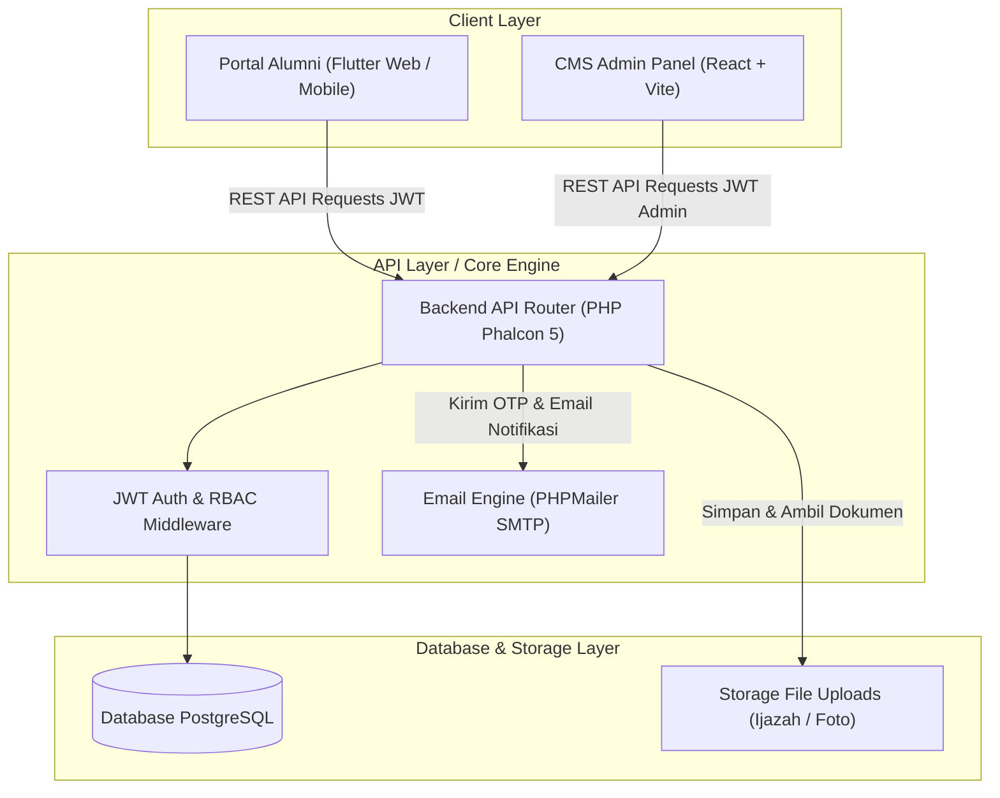
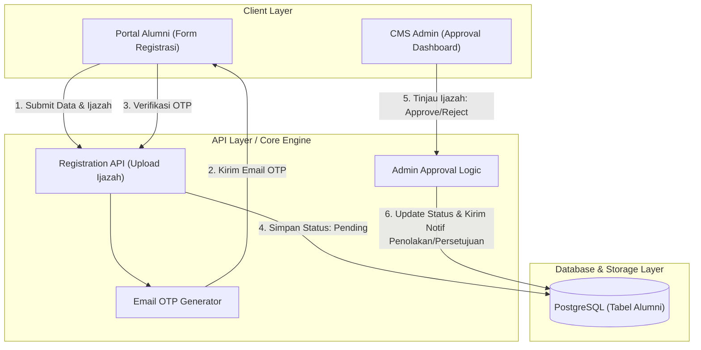
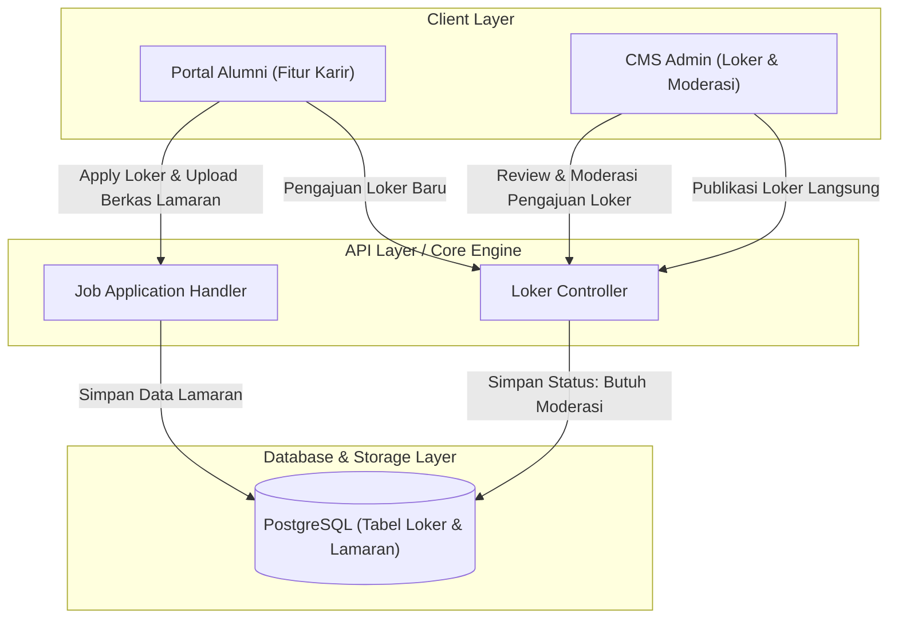
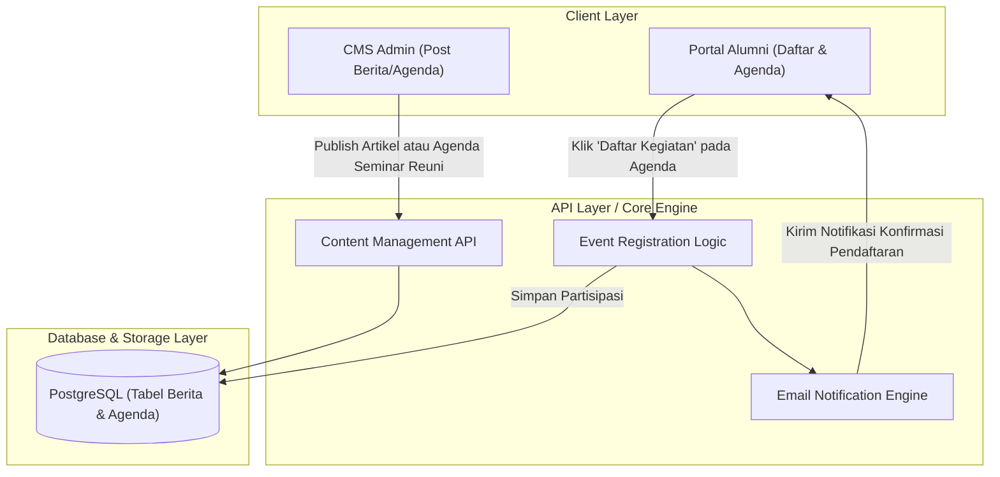
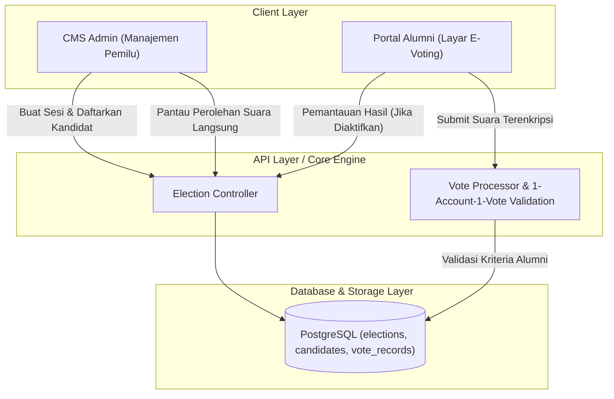
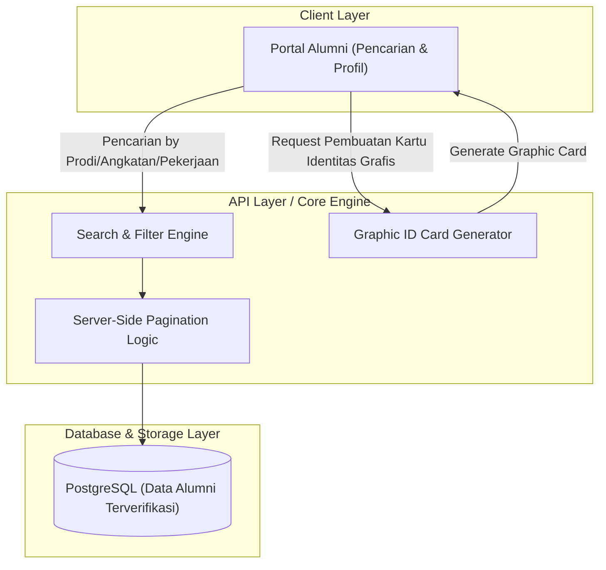
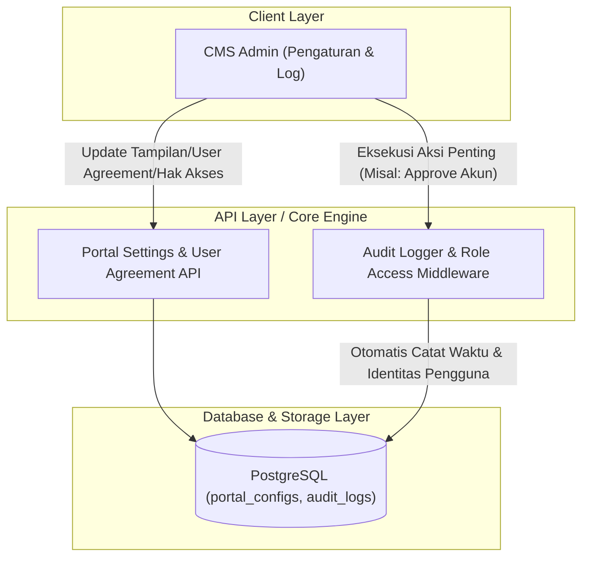

# Arsitektur & Alur Modul Sistem IKA JTK

Dokumen ini berisi diagram arsitektur sistem 3-tier serta diagram alur (*block diagram*) yang **disusun secara spesifik berdasarkan uraian Modul Fungsional di Bab 3 (Sub-bab 3.1.2.1 sampai 3.1.2.6)**.

---

## 🏛️ Arsitektur Sistem 3-Tier (Decoupled Client-Server)

> **Visualisasi komunikasi antar komponen sistem IKA JTK:**

---

## 👥 1. Modul Keanggotaan dan Verifikasi (Sesuai 3.1.2.1)

> **Alur pendaftaran mandiri, validasi email OTP, hingga persetujuan dokumen ijazah oleh admin.**

---

## 💼 2. Modul Portal Karir dan Lowongan Kerja (Sesuai 3.1.2.2)

> **Alur publikasi loker, sistem moderasi loker dari alumni, dan pengajuan lamaran.**

---

## 📰 3. Modul Berita dan Agenda Kegiatan (Sesuai 3.1.2.3)

> **Alur publikasi informasi dan registrasi kehadiran agenda beserta notifikasi email.**

---

## 🗳️ 4. Modul E-Voting Pemilu Ketua IKA JTK (Sesuai 3.1.2.4)

> **Alur manajemen pemilu, pemungutan suara aman (1 akun 1 suara), dan pemantauan langsung.**

---

## 📇 5. Modul Direktori Alumni dan Profil (Sesuai 3.1.2.5)

> **Alur pencarian jaringan profesional alumni dan pembuatan kartu identitas grafis.**

---

## ⚙️ 6. Modul Audit Log dan Pengaturan Sistem (Sesuai 3.1.2.6)

> **Alur perekaman jejak aktivitas admin, pengaturan hak akses, dan konfigurasi portal dinamis.**

